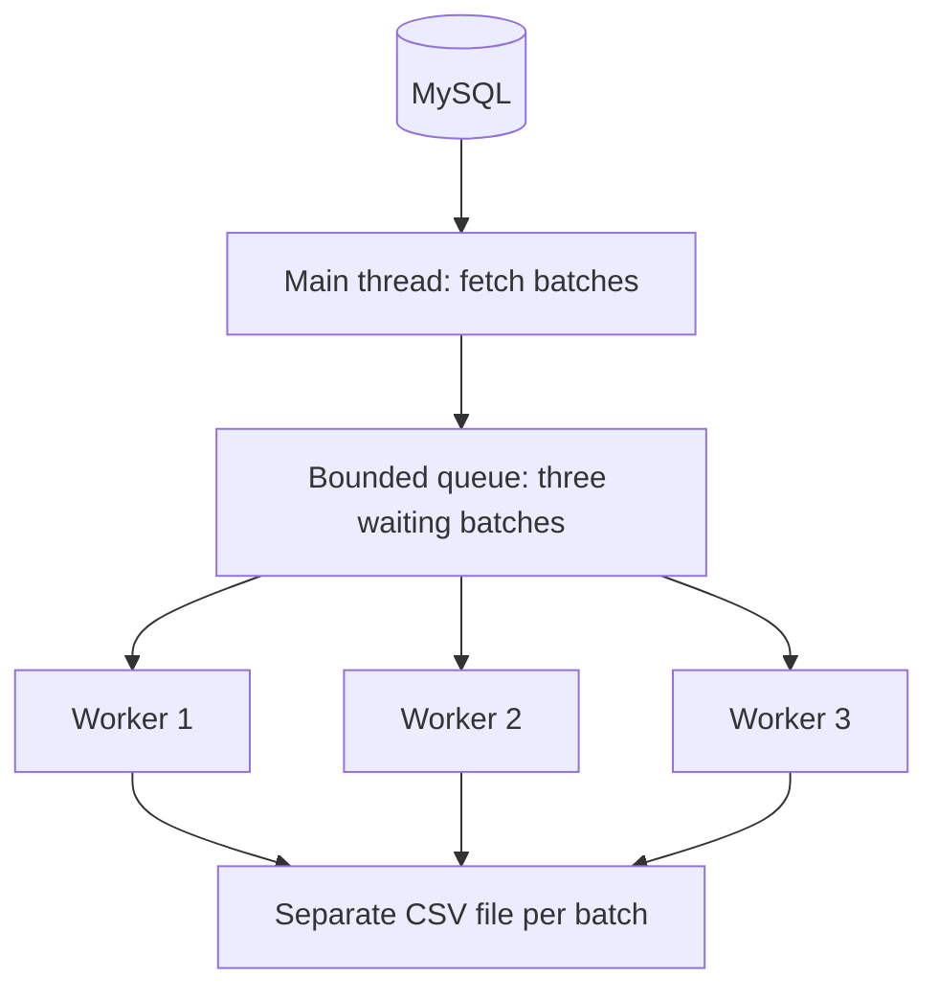

# Threads at Work: Exploring Python Concurrency

A small learning project exploring **multithreading in Python** through a practical task: exporting MySQL query results to CSV files.

The project implements the export in two ways—sequentially and with a producer–consumer pipeline—to understand how threads share work, coordinate progress, and respond to failures. It is an exercise in concurrency, rather than a production export tool or a claim that multithreading is always faster.

## What this project explores

- Distributing batches of work across worker threads.
- Using a bounded queue to coordinate a producer and consumers.
- Signaling failure across threads with a shared `Event`.
- Tracking queued work and shutting down workers with sentinels.
- Comparing sequential and concurrent execution on the same data.

The central question is: **what changes when database reading and CSV writing overlap through a queue?**

## How it works

Both modes execute a MySQL query and read its results in batches. They differ in how those batches are written to disk.

### Sequential mode

One thread fetches a batch, writes it to a single CSV file, and then fetches the next batch. This repeats until the query result is exhausted.

### Concurrent mode

The main thread acts as the **producer**: it fetches batches and puts them into a bounded queue. Three worker threads take batches from the queue and write a separate CSV file for each batch.

**Only the producer accesses the database connection and cursor.** Workers process rows that have already been fetched; they do not run parallel database queries.



| Concept | Implementation |
|---|---|
| Producer–consumer pattern | One reader supplies batches; workers write them |
| Backpressure | `Queue(maxsize=3)` makes the producer wait when the queue is full |
| Work tracking | Each `get()` is paired with `task_done()`; queue `join()` waits for all acknowledgments |
| Failure signaling | Workers record exceptions in an error queue and set a shared `Event` |
| Worker shutdown | One `None` sentinel per worker, followed by thread joins |
| File finalization | A `.csv.part` file is renamed after writing succeeds |

Queue capacity limits **waiting batches**, not rows or total memory. The producer and active workers may also hold batches outside the queue.

## Setup

Requirements:

- Python 3.13 or newer.
- `uv`.
- Access to a MySQL database containing the data you want to export.

From the repository root, install dependencies:

```bash
uv sync
```

Configure `src/concurrency/config/config.yaml`:

| Configuration | Purpose |
|---|---|
| `env.database_config` | Connection settings: `host`, `port`, `user`, `database`, and `password` |
| `env.global_config.batch_size` | Maximum rows fetched per batch |
| `env.global_config.root` | Populated by the configuration loader using the source directory layout |

The loader validates the YAML against dataclass schemas using OmegaConf, then converts it into nested Python dictionaries. Use your local connection settings and keep real credentials out of commits.

### Choose your dataset

Update `FETCH_QUERY` in `src/concurrency/script/__init__.py` for your own table and columns.

The current query reads `statement_clean.transactions_clean` and selects `statement_id`, `date`, `narration`, `amount`, `direction`, and `balance`. Because the query explicitly names the database, changing the database configuration alone will not redirect it to another database.

For a small trial, limit the query result and use a batch size of `1000` so worker activity is easier to observe. Worker count and queue capacity are constants in `src/concurrency/script/concurrent.py`, rather than CLI options.

## Run an export

```bash
uv run concurrency sequential
uv run concurrency concurrent
```

Omitting the mode selects concurrent processing:

```bash
uv run concurrency
```

You can also use the module entry point or inspect the CLI help:

```bash
uv run python -m concurrency sequential
uv run concurrency --help
```

| Mode | Output |
|---|---|
| Sequential | `data/transaction.csv`, replaced after a successful export |
| Concurrent | `data/<unique-run-id>/batch_000001.csv`, with one file per batch |

Output directories are created automatically, and generated data is ignored by Git. Each concurrent batch file contains its own header.

## Failure behavior and limitations

- If a worker fails, a shared event signals the producer to stop fetching at its next check. Workers retrieve and acknowledge waiting batches but skip processing them. Work already underway may still finish.
- The caller reports failure after shutdown. Already completed files remain, so the export is **not all-or-nothing**. A finalized batch file does not mean the entire export succeeded.
- Interrupted exports do not automatically resume, and concurrent batch files are not automatically merged.
- The query has no `ORDER BY`, so row ordering is not guaranteed. Workers may also finish batches out of order.
- The concurrent mode overlaps reading and writing; it does not make the single database result stream parallel.

## Local observations

During development, twelve local exports of **148,834 rows** compared the two modes using batch sizes of `100000` and `1000`.

| Mode | Batch size | Batches | CSV files | Median elapsed time | Range across 3 runs |
|---|---:|---:|---:|---:|---:|
| Sequential | 100,000 | 2 | 1 | 26.104 s | 19.299–41.696 s |
| Concurrent | 100,000 | 2 | 2 | 27.885 s | 25.334–38.789 s |
| Sequential | 1,000 | 149 | 1 | 24.171 s | 22.778–26.055 s |
| Concurrent | 1,000 | 149 | 149 | 27.585 s | 24.416–27.814 s |

| Observation | What it illustrates |
|---|---|
| At `100000` rows per batch, only two batches were available and one of the three workers remained idle | The number of tasks limits worker participation |
| At `1000` rows per batch, all workers shared 149 batches | Smaller batches made work distribution easier to observe |
| The data queue held at most one waiting batch | These runs did not demonstrate backpressure from a full queue |
| Concurrent mode had a higher median elapsed time at both batch sizes | Adding threads did not improve elapsed time in this experiment |
| All exports contained matching data and all workers shut down cleanly | The observed runs completed as intended |

These are local observations, not a general benchmark. Timings varied, and the modes also differ in output layout: one CSV versus multiple batch files. The experiment compares the complete implementations, rather than isolating thread overhead alone.

The main takeaway was that **concurrency changes how work is coordinated; a speed improvement depends on the workload and its bottlenecks**.

## Tests

```bash
uv run python -m unittest discover -s tests -v
```

Tests use mocked database connections and temporary CSV files. They cover CLI dispatch, sequential and concurrent exports, and connection cleanup after query failure. They do not replace integration testing against a live MySQL server.

